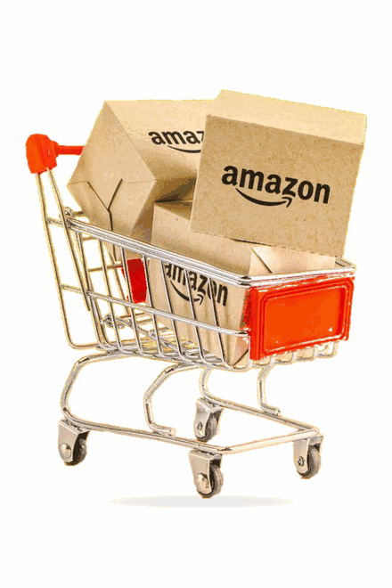

# Amazon Scraper

<p align="center">
  
</p>

Outil de collecte de données produit sur plusieurs boutiques Amazon. Le projet combine Selenium et Chrome pour parcourir les résultats, une interface de bureau PyQt6 pour configurer et suivre la collecte, puis SQLite et CSV pour conserver les données.

Auteur : EDERE HERVE REGINA

## Fonctionnalités

- Sélection d’une ou plusieurs catégories de produits.
- Choix parmi dix boutiques Amazon : France, États-Unis, Royaume-Uni, Canada, Allemagne, Espagne, Italie, Japon, Australie et Brésil.
- Limite configurable jusqu’à 50 produits par collecte.
- Suivi de l’avancement et messages d’état dans l’interface.
- Enregistrement des résultats dans SQLite et export CSV.

- Capture des images produit dans `data/images/` avec Selenium.
- Aucune URL de produit n’est sauvegardée.

## Catégories

Téléphones portables, casques Bluetooth, télévisions, GPS, accessoires sans fil, univers Hi-Fi, photo et caméscope.

## Données collectées

Selon les informations affichées sur la page, le scraper peut enregistrer le nom du produit, la catégorie, le prix, la note, le nombre d’avis, la disponibilité et la boutique Amazon concernée.

## Technologies

| Technologie | Utilisation |
| --- | --- |
| Python | Logique de l’application |
| Selenium | Automatisation du navigateur et collecte des résultats |
| Google Chrome | Navigateur piloté par Selenium |
| PyQt6 | Interface graphique |
| SQLite | Stockage local des produits |
| CSV | Export tabulaire, compatible avec Excel |

## Structure

```text
amazon_scraper/                         # Racine du projet
├── app/                                 # Code de l’application
│   ├── controllers/                     # Coordination de la collecte
│   │   ├── __init__.py                  # Initialise le package controllers
│   │   └── scraping_controller.py       # Lance la collecte et les sauvegardes
│   ├── models/                          # Modèles et accès aux données
│   │   ├── __init__.py                  # Initialise le package models
│   │   ├── depot.py                     # Enregistre et lit les produits dans SQLite
│   │   └── produit.py                   # Définit le modèle Product
│   ├── scraper/                         # Automatisation et extraction Selenium
│   │   ├── __init__.py                  # Initialise le package scraper
│   │   ├── amazon_scraper.py            # Parcourt les recherches Amazon
│   │   ├── driver.py                    # Configure et ouvre Chrome
│   │   └── parsing.py                   # Extrait les informations des produits
│   └── views/                           # Interface et présentations des résultats
│       ├── __init__.py                  # Initialise le package views
│       ├── console_view.py              # Affiche le résumé dans le terminal
│       ├── export_view.py               # Exporte les produits au format CSV
│       └── main_window.py               # Interface graphique PyQt6
├── data/                                # Données locales
│   ├── amazon_scraper.sqlite3           # Données des produits collectés
│   └── images/                          # Images capturées par Selenium
│       └── .gitkeep                   # Conserve le dossier dans Git
├── exports/                             # Fichiers exportés
│   └── produits.csv                     # Résultats de la dernière collecte
├── tests/                               # Dossier réservé aux tests
│   └── __init__.py                      # Initialise le package tests
├── .gitignore                           # Fichiers ignorés par Git
├── README.md                            # Documentation du projet
├── config.py                            # Catégories, boutiques et paramètres
├── main.py                              # Point de démarrage de l’application
└── requirements.txt                     # Dépendances Python
```

## Prérequis

- Python 3.10 ou plus récent.
- Google Chrome installé.
- Une connexion Internet pour la collecte et le premier lancement de Selenium.

## Bibliothèques et outils

Le projet utilise les paquets Python suivants, déclarés dans `requirements.txt` :

| Paquet | Utilisation |
| --- | --- |
| `selenium` | Piloter Chrome et parcourir les pages Amazon. |
| `PyQt6` | Construire l’interface graphique. |

Le stockage SQLite (`sqlite3`), la lecture et l’écriture CSV (`csv`), ainsi que `dataclasses`, `pathlib`, `datetime` et d’autres modules utilisés sont inclus dans Python : ils ne s’installent pas avec `pip`. Selenium Manager récupère et configure automatiquement le pilote Chrome nécessaire ; il n’est pas nécessaire d’installer ChromeDriver manuellement.

## Installation

Ouvre le dossier `amazon_scraper` dans Visual Studio Code, puis ouvre un terminal à la racine du projet. Sous Windows PowerShell, crée un environnement virtuel et active-le :

```powershell
python -m venv .venv
.\.venv\Scripts\Activate.ps1
```

Si un environnement virtuel est déjà actif, tu peux passer cette étape. Installe ensuite les paquets du projet :

```powershell
python -m pip install -r requirements.txt
```

Pour vérifier Python et les dépendances installées :

```powershell
python --version
python -m pip show selenium PyQt6
```

## Démarrage

Lance l’application avec :

```powershell
python main.py
```

Dans la fenêtre, sélectionne les catégories, la boutique Amazon et le nombre maximal de produits, puis lance la collecte. Chrome est visible pendant l’exécution ; garde la fenêtre ouverte jusqu’à la fin.

## Stockage et exports

| Fichier ou dossier | Description |
| --- | --- |
| `data/amazon_scraper.sqlite3` | Base SQLite persistante. Les produits sont identifiés par boutique, catégorie et titre ; une nouvelle collecte met à jour les correspondances existantes. |
| `data/images/` | Images PNG capturées par Selenium depuis les résultats Amazon. Les noms permettent de retrouver la catégorie et le produit. |
| `exports/produits.csv` | Export de la collecte, avec des en-têtes français et des colonnes séparées par des points-virgules. |

Les dossiers nécessaires sont créés automatiquement. Les images sont des captures des visuels affichés dans Chrome ; aucune URL de page produit n’est enregistrée. Aucun rapport HTML n’est généré.
## Configuration

Les réglages principaux se trouvent dans `config.py`. Ils déterminent où les données sont enregistrées, quelle boutique Amazon est utilisée, quels mots-clés sont recherchés et comment Selenium attend le chargement des pages.

### Fichiers et dossiers de données

| Paramètre | Valeur par défaut | Rôle |
| --- | --- | --- |
| `BASE_DIR` | Dossier contenant `config.py` | Sert de point de départ pour construire les chemins du projet. |
| `DATA_DIR` | `data/` | Dossier de la base de données locale. |
| `IMAGE_DIR` | `data/images/` | Dossier où sont enregistrées les captures d’images produit. |
| `EXPORT_DIR` | `exports/` | Dossier des fichiers exportés. |
| `DATABASE_PATH` | `data/amazon_scraper.sqlite3` | Chemin du fichier SQLite, qui conserve les produits entre les collectes. |
| `CSV_PATH` | `exports/produits.csv` | Chemin du CSV produit par la dernière collecte. |

Ces chemins sont calculés à partir de l’emplacement du projet. Il n’est donc pas nécessaire de remplacer les chemins par un chemin propre à un ordinateur. L’application crée les dossiers de données et d’export s’ils n’existent pas.

### Limite et comportement du navigateur

| Paramètre | Valeur par défaut | Rôle |
| --- | --- | --- |
| `MAX_PRODUCTS_TOTAL` | `50` | Plafond global du nombre de produits demandé pour une collecte. L’interface permet de choisir une limite jusqu’à ce maximum. |
| `HEADLESS` | `False` | Avec `False`, la fenêtre Chrome reste visible pendant la collecte. Avec `True`, Chrome fonctionne sans afficher sa fenêtre. |

Le plafond de 50 est une limite maximale, pas une garantie d’obtenir exactement 50 résultats. Amazon peut afficher moins de produits, demander une vérification ou ne pas fournir certaines informations.

### Délais Selenium

| Paramètre | Valeur par défaut | Rôle |
| --- | --- | --- |
| `PAGE_LOAD_TIMEOUT_SECONDS` | `30` secondes | Durée maximale accordée au chargement d’une page avant de considérer l’attente comme échouée. |
| `ELEMENT_WAIT_SECONDS` | `12` secondes | Durée maximale pendant laquelle Selenium attend qu’un élément nécessaire apparaisse. |
| `IMAGE_LOAD_TIMEOUT_SECONDS` | `5` secondes | Temps maximal de chargement des images du produit dans Chrome. |
| `REQUEST_PAUSE_SECONDS` | `2` secondes | Pause entre certaines actions de navigation pour laisser la page se stabiliser. |

Ces délais sont exprimés en secondes. Les augmenter peut aider avec une connexion lente, mais rend aussi la collecte plus longue. Selenium pilote Chrome ; le projet n’utilise pas la bibliothèque `requests` pour récupérer les pages.

### Boutiques Amazon

`MARKETPLACES` regroupe les dix boutiques disponibles. Chaque entrée contient :

- `label` : le nom présenté dans l’application, par exemple `France — Amazon.fr` ;
- `url` : l’adresse de la boutique Amazon à ouvrir ;
- `language` : le code utilisé pour choisir les mots-clés de recherche ;
- `locale` : la langue et la région communiquées au navigateur, par exemple `fr-FR` ou `en-US`.

Pour ajouter ou corriger une boutique, modifie son entrée dans `MARKETPLACES` en conservant ces quatre champs. La boutique choisie détermine le site visité et les informations de marché associées aux produits sauvegardés.

### Catégories et mots-clés

`CATEGORY_LABELS` associe chaque identifiant interne à son nom affiché : téléphones portables, casques Bluetooth, télévisions, GPS, accessoires sans fil, univers Hi-Fi et photo/caméscope. `CATEGORY_QUERIES` contient les expressions réellement saisies dans la recherche Amazon, traduites selon les langues prises en charge : français (`fr`), anglais (`en`), allemand (`de`), espagnol (`es`), italien (`it`), japonais (`ja`) et portugais (`pt`).

Pour ajuster une recherche, modifie l’expression de la catégorie voulue dans la langue correspondante. Garde les mêmes identifiants de catégorie dans `CATEGORY_LABELS` et dans les différents dictionnaires de `CATEGORY_QUERIES` : ils servent à faire le lien entre le nom affiché et la recherche lancée. `CATEGORIES` et `AMAZON_BASE_URL` sont des raccourcis définis par défaut pour la France ; le choix d’une autre boutique dans l’application utilise ses propres paramètres.
## Limites

Le contenu et la structure des pages Amazon peuvent varier selon la boutique ou évoluer dans le temps ; les informations récupérées peuvent donc être incomplètes et les sélecteurs peuvent nécessiter une mise à jour. Amazon peut aussi présenter un CAPTCHA ou limiter l’accès. Le scraper ne contourne pas ces protections.

---

Projet réalisé par EDERE HERVE REGINA
